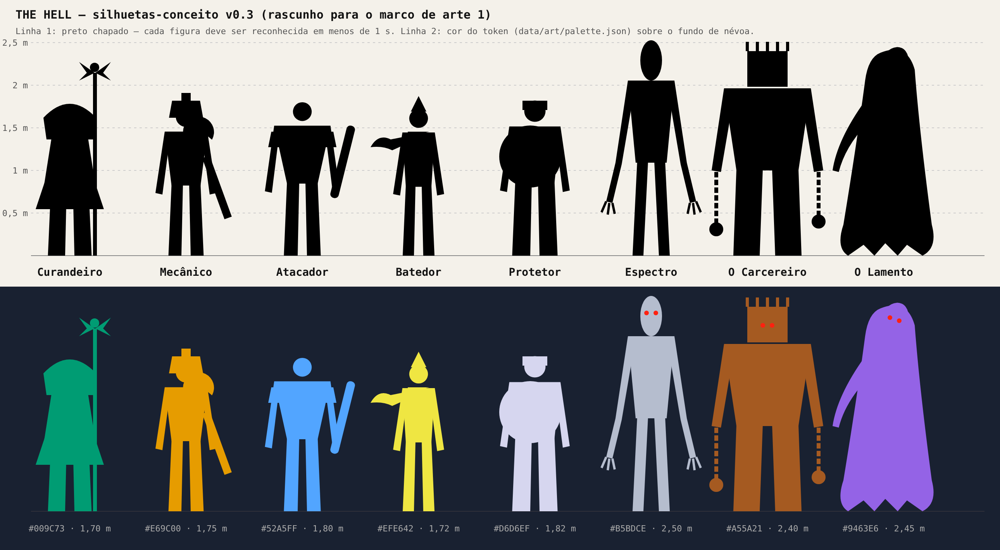

# THE HELL — Art Bible v0.3

**Anexo do GDD v0.3 · 08/11/2026 · aguarda aprovação do marco de arte 1**

THE HELL parece um jogo de PlayStation 1 achado num porão: pouca resolução, cor contada, névoa grossa e polígonos que tremem. O medo vem do que não se vê direito. Mas o que importa para jogar (quem é quem, onde está o gerador, de onde vem o perigo) tem que ser lido em menos de 1 segundo, mesmo com o granulado (GDD-v0.2 §1, pilar 5).

Este documento transforma a seção 10 do GDD em regras que dá para conferir. Tudo o que tem número está em [`data/art/palette.json`](../data/art/palette.json) ou [`data/balance.yaml`](../data/balance.yaml) e é testado por script.

*Folha de silhuetas-conceito (rascunho de proporção e forma, não arte final). Gerada por `node tools/art/silhouettes.mjs`. Escala: régua em metros.*

---

## 1. Regras de ouro

1. **Cor é informação.** O mundo é quase sem cor (cinzas frios, marrom escuro, névoa azul-escura). Cor saturada só aparece em personagens, geradores, perigo e interface.
2. **Forma antes de cor.** Cada personagem é reconhecido pela silhueta em preto. A cor confirma, nunca é a única pista. Isso garante a leitura para quem é daltônico.
3. **Sem sangue, sem gore.** Nada de sangue, feridas abertas, órgãos, membros cortados ou cadáveres. Ferimento aparece como pegadas luminosas, faísca, tremor e som (GDD-v0.2 §3.2, §10.4). Classificação alvo 12+.
4. **Do PS1, só o charme.** Tremor de vértice, textura torta e dither são estilo; tudo isso tem intensidade de 0 a 1 no menu de acessibilidade (GDD-v0.3 §10.1).
5. **O caçador avisa.** Todo ataque tem aviso visual de pelo menos 0,4 s: os olhos acendem mais forte antes do dash e do golpe (GDD-v0.2 §10.4).

## 2. Paleta

Paleta de 15 bits (5 bits por canal, como no PS1). Os tokens abaixo são a fonte única: o jogo, a UI e esta Art Bible leem de `data/art/palette.json`.

| Grupo | Tokens | Regra |
| --- | --- | --- |
| Mundo | `world.fog` #192131, `world.wall` #313139, `world.ground` #313129 | Escuro e frio. Nenhum token de mundo pode competir com cor de personagem |
| Classes | Curandeiro #009C73, Mecânico #E69C00, Atacador #52A5FF, Batedor #EFE642, Protetor #D6D6EF | Base na paleta de Okabe e Ito, feita para daltônicos, ajustada em 15 bits e testada (seção 5) |
| Geradores | pendente #D66300, em progresso #F7DE31, pronto #21C5A5, bônus #EF63DE | Cada estado tem também um padrão de piscar próprio (seção 4) |
| Caçadores | Espectro #B5BDCE, O Carcereiro #A55A21, O Lamento #9463E6; olhos #FF2110 | Cada caçador tem cor dominante e cabeça diferentes (GDD-v0.2 §10.4) |
| Interface | fundo #101019, painel #212131, texto #EFE6D6, texto secundário #9C9CA5, destaque #FFB531, perigo #FF4A29 | Texto ≥ 4,5:1 contra o fundo |

A tabela completa, com os valores de 5 bits, está em [`art/palette-report.md`](art/palette-report.md).

**O que mudou durante os testes.** A primeira versão da paleta falhou em 6 testes: Curandeiro, Atacador e Protetor sumiam contra a parede; O Lamento sumia na névoa; Mecânico × Protetor e os feixes "pronto" × "bônus" ficavam iguais para quem tem tritanopia. Correções: parede mais escura, Atacador em azul-céu, Protetor em prata, O Lamento mais claro e feixe bônus em magenta. A versão atual passa em todos.

## 3. Silhuetas

Cada personagem tem uma **forma-chave** que não muda com skin nenhuma. Skins trocam cores secundárias e acessórios pequenos, nunca a forma-chave nem a cor dominante da classe (GDD-v0.2 §10.3).

### Sobreviventes (altura 1,70 a 1,82 m)

| Classe | Forma-chave (nunca muda) | Acessório | Por que essa forma |
| --- | --- | --- | --- |
| Curandeiro | capuz arredondado e manto que abre embaixo | cajado com caduceu, mais alto que a cabeça | o cajado é a única linha vertical acima da cabeça entre os sobreviventes |
| Mecânico | capacete com lanterna (quadrado no topo da cabeça) | chave inglesa grande na mão | o capacete quadrado se lê de longe |
| Atacador | ombros muito largos, cabeça pequena (triângulo invertido) | bastão | o corpo em V é a forma do "lutador" |
| Batedor | corpo mais fino e cabeça com ponta | cachecol que voa para trás | o cachecol mostra a direção e a velocidade |
| Protetor | corpo largo e reto | escudo redondo nas costas | o círculo grande atrás do tronco é único |

### Caçadores (altura 2,40 a 2,50 m)

| Caçador | Forma-chave | Cabeça | Detalhe |
| --- | --- | --- | --- |
| Espectro (lançamento) | alto e magro, braços que passam do joelho | oval alongada, sem rosto | dedos longos |
| O Carcereiro | largo como um armário | gaiola quadrada com barras no topo | correntes com bola nas mãos |
| O Lamento | véu longo, sem pernas, flutua | inclinada para o lado | um braço estendido |

Todos os caçadores têm dois olhos vermelhos emissivos (`hunter.olhos`). Eles são a primeira coisa visível na névoa.

**Ponto de atenção.** O Protetor (prata) e o Espectro (cinza-azulado) são os dois personagens claros. A diferença de altura (1,82 m × 2,50 m), os olhos vermelhos e os braços longos separam os dois. Esse par é o primeiro do teste de silhueta com pessoas (seção 5.1).

## 4. Leitura de estados no jogo

| Estado | Como se mostra | Sem depender só de cor |
| --- | --- | --- |
| Gerador pendente | feixe laranja-avermelhado | pisca devagar (1 vez por segundo) |
| Gerador em progresso | feixe amarelo | pulsa (2 vezes por segundo) |
| Gerador pronto | feixe verde-água | luz contínua |
| Gerador bônus | feixe magenta | gira em espiral, com um losango no topo |
| Aliado preso | marcador âmbar acima da gaiola + retrato com cadeado no HUD | ícone de cadeado |
| Ferido ([Proposta] GDD-v0.2 §3.2) | pegadas que brilham a cada 2 s | brilho, nunca sangue |
| Ataque do caçador chegando | olhos acendem mais 0,4 s antes | som próprio de cada habilidade junto |
| Caçador perto | seta vermelha na borda da tela (a < 15 m ou revelado) | seta tem forma, não só cor |

O protótipo usa vermelho para pendente e verde para pronto (GDD-v0.2 §9.1). Para quem tem protanopia ou deuteranopia, vermelho e verde viram a mesma cor; por isso a troca de tons e os padrões de piscar acima.

## 5. Testes obrigatórios

### 5.1 Teste de silhueta

- **Agora (conceito):** a folha acima mostra as 8 figuras em preto chapado. Nenhuma depende de cor para ser diferente das outras.
- **No marco de arte 2 (modelos reais):** captura automática de cada personagem em preto chapado, de frente, de lado e de costas, a 384×216. Teste com 5 pessoas (o filho incluído): a imagem aparece por 1 s e a pessoa diz quem é. **Aceite:** ≥ 90% de acertos por personagem.

### 5.2 Daltonismo (simulação)

O script `tools/art/palette-check.mjs` simula protanopia, deuteranopia e tritanopia (modelo de Machado, Oliveira e Fernandes, 2009) e mede a diferença entre cores do mesmo grupo (CIEDE2000). Mínimo exigido: 12.

| Grupo | Normal | Protanopia | Deuteranopia | Tritanopia | Par mais próximo | Resultado |
| --- | --- | --- | --- | --- | --- | --- |
| Classes | 23,6 | 16,2 | 12,3 | 12,7 | Mecânico × Batedor (deuteranopia) | passa |
| Geradores | 37,1 | 24,8 | 20,1 | 14,6 | pendente × bônus (tritanopia) | passa |
| Caçadores | 26,4 | 27,5 | 26,7 | 24,8 | Espectro × O Lamento (tritanopia) | passa |

O par mais apertado é Mecânico × Batedor para deuteranopia (12,3). A diferença de forma (capacete com chave × corpo fino com cachecol) cobre isso, e o Batedor só entra na fase 4.

Nas capturas de tela das fases 2 e 4, repetir o teste com a emulação de deficiência visual do Chrome DevTools (aba Rendering), que simula as mesmas três condições na imagem real.

As 3 paletas do modo daltônico (GDD-v0.2 §12.4) serão variações desta paleta, e cada uma tem que passar no mesmo script.

### 5.3 Contraste

| Teste | Mínimo | Resultado |
| --- | --- | --- |
| Texto da interface sobre fundo e painel (6 pares) | 4,5:1 (WCAG 2.2, 1.4.3) | menor: perigo sobre painel, 4,72:1 |
| Personagens, feixes e olhos sobre névoa e parede (20 pares) | 3:1 (WCAG 2.2, 1.4.11) | todos passam; menor: O Carcereiro sobre névoa, 3,13:1 |

Rodar: `node tools/art/palette-check.mjs --md`. O script sai com erro se algum teste falhar e entra na CI na fase 0.

## 6. Mood board

**A referência principal são os desenhos do filho.** **LACUNA:** ainda não estão no repositório. Pedido: fotos ou digitalizações em `docs/art/referencias/filho/`, uma pasta por personagem ou mapa.

Referências externas só de domínio público ou com licença aberta, com a licença registrada em `docs/art/referencias/LICENCAS.md`. Direções para a coleta na fase 2 (obras em domínio público por idade; links e licenças a conferir antes de entrar no repositório):

| Para | Direção | Obra de referência |
| --- | --- | --- |
| Tom geral | gravura escura, muita sombra, figuras pequenas contra o ambiente | ilustrações de Gustave Doré para *A Divina Comédia* (1857–1867) |
| Floresta Nebulosa | névoa que engole o fundo, árvores como silhuetas | pinturas de névoa de Caspar David Friedrich (início do século XIX) |
| Clima do mapa e do menu | ilha escura, silêncio, simetria | *A Ilha dos Mortos*, Arnold Böcklin (1880–1886) |
| Look técnico | resolução baixa, textura 32–64 px, névoa curta | capturas próprias do protótipo e do shader da fase 2 |

Imagens de jogos comerciais não entram no repositório nem no mood board (direito autoral).

## 7. Especificação de modelos

| Item | Sobrevivente | Caçador | Fonte |
| --- | --- | --- | --- |
| Triângulos | 300 a 600 | 800 a 1.200 | GDD-v0.2 §10.3 |
| Textura | atlas 64×64, filtro nearest | atlas 64×64 | GDD-v0.2 §10.3 |
| Animação | 12 FPS em passos; 9 clipes | 12 FPS; 9 clipes | GDD-v0.2 §10.3 |
| Formato | glTF 2.0 binário (`.glb`), sem erros no glTF-Validator | igual | GDD-v0.3 §9.4 |
| Nomes dos clipes | `idle`, `andar`, `correr`, `interagir`, `ferido`, `preso`, `golpe`, `dash`, `atordoado` | igual | — |
| Skins | troca de paleta secundária e acessório pequeno; forma-chave e cor dominante fixas | igual | seção 3 |

Esqueleto e animações-base podem vir de pacotes CC0 já usados no Caçada Sombria (Quaternius, Universal Animation Library), com proporções ajustadas por classe.

## 8. Interface

- **Fonte:** pixel, com licença aberta (OFL). **LACUNA:** escolher a fonte e confirmar que tem todos os acentos de pt-BR e es (ã õ ç á é í ó ú â ê ô à ü ñ ¿ ¡). Teste: renderizar a frase de teste nos 3 tamanhos.
- **Molduras:** 2 px, 9-slice, cor `ui.panel` com borda `ui.text_dim`.
- **Ícones:** 16 e 32 px; um ícone por classe com a forma-chave da seção 3 (cajado, chave, bastão, cachecol, escudo).
- **Foco de teclado e gamepad:** contorno de 2 px em `ui.accent`, sempre visível.
- **Contraste mínimo** 4,5:1 (seção 5.3).

## 9. Marcos de arte (aprovação do filho)

Cada marco é aprovado num comentário na issue do marco no GitHub. Sem aprovação, a fase seguinte de arte não começa.

| Marco | O que ele vê | Quando |
| --- | --- | --- |
| A1 | Esta Art Bible: paleta, silhuetas-conceito, regras | agora |
| A2 | Primeiro sobrevivente e o Espectro modelados e animados, no shader PS1 | fase 2 |
| A3 | Mapa 1 (Pátio) com iluminação, névoa e feixes | fase 2 |
| A4 | Interface completa (menu, lobby, HUD, loja, resumo) | fase 3 |
| A5 | Mapas 2 e 3, Batedor, Protetor e o segundo caçador | fase 4 |

**Perguntas para o marco A1:**

1. As formas-chave da seção 3 são as que você imaginou para cada classe e caçador? O que trocaria?
2. As cores das classes combinam com a personalidade de cada uma?
3. O feixe do gerador bônus em magenta funciona, ou prefere outra cor? (Ela precisa passar no teste da seção 5.)
4. Tem desenhos seus que devem virar a referência principal?
