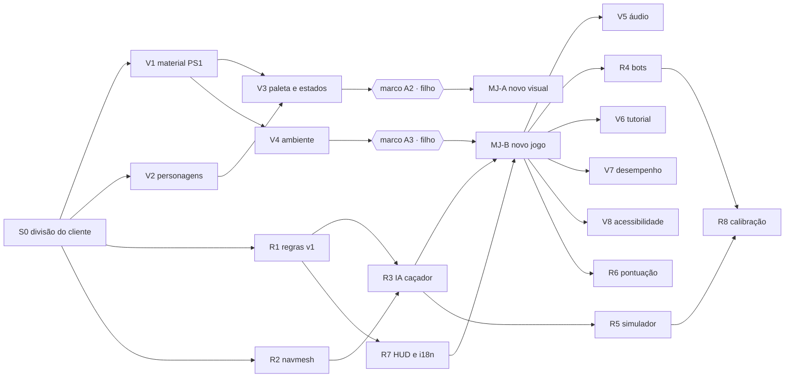

# THE HELL — Plano técnico das fases 1 e 2 em paralelo (handoff ao orquestrador)

> **09/11/2026:** o trabalho foi dividido em 3 sessões. Esta sessão (Visual) segue com A2, A2b, A3, V6, V7, V8 e V9. R4, R5, R6, R8 e a troca do MJ-B passam para a [Frente R](plano-frente-r.md); V5 passa para o [Áudio](plano-audio-v5.md). Propriedade de arquivos e convivência: [`sessoes.md`](sessoes.md).

**08/11/2026 · decisão do Rodrigo: fases 1 (regras e IA) e 2 (visual e áudio) em paralelo, com prioridade para o visual**

Este documento é a ordem de serviço do orquestrador que assume o projeto a partir de `main` em `803ac01`. Ele resume o estado, fixa o escopo, divide o trabalho entre agentes e diz como provar cada entrega. Em conflito com outro documento, vale esta ordem: GDD v0.3 > GDD v0.2 > este plano > plano de construção (só para o que este plano não cobre).

---

## 1. Objetivo e marcos de teste

Entregar ao Rodrigo e ao filho, em https://the-hell-staging.fly.dev, versões jogáveis cada vez mais próximas do jogo final. O **visual vem primeiro**: o filho valoriza a direção de arte acima de tudo.

| Marco jogável | Conteúdo mínimo | Portão humano | Critério de saída |
| --- | --- | --- | --- |
| **MJ-A "novo visual"** (primeiro a sair) | Material PS1 (V1), personagens do marco A1 com animação (V2, V3), paleta aprovada nos feixes e no HUD, Pátio com camada A de pós-processamento (V4 parcial). Regras ainda podem ser as do protótipo | **Marco de arte A2** aprovado pelo filho | CI verde; capturas de referência aprovadas; staging atualizado |
| **MJ-B "novo jogo"** | MJ-A + regras v1 (R1), navmesh e IA do caçador (R2, R3), HUD completo (R7), Pátio com iluminação final (V4) | **Marco de arte A3** aprovado pelo filho | 1.000 partidas simuladas sem trava; cobertura de `packages/sim` ≥ 90% |
| **MJ-C "fase 1 + 2 completas"** | MJ-B + áudio adaptativo (V5), bots competentes (R4), simulador na CI (R5), pontuação e dificuldades (R6), tutorial (V6), desempenho (V7), acessibilidade (V8) | 5 partidas do Rodrigo e do filho (calibração R8) | critérios de saída das fases 1 e 2 do plano (`docs/plano-construcao.md` §1) |

Depois de cada marco: resumo de 1 página ao Rodrigo (o que entrou, métricas, link do staging, decisões pendentes em múltipla escolha). Produção só com aprovação explícita do Rodrigo.

## 2. Estado de partida (verificado em 08/11/2026)

| Item | Estado |
| --- | --- |
| Repositório | `rodaquino-OMNI/The-Hell-Game`, público, `main` em `803ac01` |
| Monorepo | pnpm 10.28 (`packageManager`), Node 22; `packages/sim` (regras determinísticas), `packages/shared` (schema zod + carga de `data/`), `packages/client` (Vite 8 + three.js 0.186.1), `packages/server` (Express, `/healthz`, bundle autossuficiente) |
| Dados | `data/balance.yaml` 0.3.1 com `ruleset: prototype`; `data/maps/patio.json`; `data/art/palette.json` (tokens aprovados no marco A1) |
| Testes | 43 (34 de paridade com o protótipo, determinismo em 100 execuções, dados, servidor); cobertura de `sim` 98% das linhas |
| CI (`.github/workflows/ci.yml`) | lint, typecheck, cobertura ≥ 90%, paleta, build, fumaça no Chromium (jogo e protótipo), gitleaks v3, deploy automático de staging em `main` com `FLY_API_TOKEN` (funcionando); runs em `main` não são cancelados |
| Produção | https://the-hell.fly.dev em `c2b08ff`; deploy só manual (`Deploy produção`, digitar `PRODUCAO`) com aprovação do Rodrigo |
| Agentes | 11 em `.claude/agents/` (produtor, simulacao, gameplay, ia, rede, render, arte-tecnica, audio, ui-ux, qa, devops) |
| Decisões | todas tomadas (`docs/plano-construcao.md` §7): D-01 basta 1 escapar; D-02 10 min; D-03 caçador 4,3 m/s; D-04 1 moeda/ponto, skins 640–2.000; D-05 simulador como porta de regressão; D-06 Floresta e Parque; D-07 convidado; D-08 premium fora; D-09 3 caçadores; D-11 agentes fazem merge após CI verde; D-12 repositório público |
| Arte | marco A1 aprovado pelo filho (revisão 2): Atacador vermelho #E64242 com corpo do Mecânico e espada nas costas; Protetor com escudo no braço; bônus magenta |

## 3. Regras invioláveis (valem para todo agente)

1. **Nada de número de jogo no código.** Todo valor vem de `data/balance.yaml` ou `data/art/palette.json`, com o schema em `packages/shared/src/schema.ts` atualizado e a seção do GDD citada em comentário.
2. **`Math.random` proibido em `packages/sim`** (regra de lint já ativa). No cliente, use PRNG com semente onde o resultado precisar ser reproduzível (texturas procedurais das capturas de referência).
3. **Paridade preservada.** A suíte `packages/sim/test/parity.test.ts` roda com `ruleset: prototype` e continua verde até o fim da fase 1. Regras novas entram atrás de `ruleset: v1`, com suíte própria. O padrão em `data/balance.yaml` só muda para `v1` no marco MJ-B.
4. **Sem gore, sem caixas de loot, nada pago com vantagem.** Fora de escopo: qualquer coisa fora do GDD (Steam, mobile nativo, voz, chat livre).
5. **Assets só CC0 ou de licença aberta compatível**, com licença conferida na página de origem e registrada linha a linha em `packages/client/public/media/creditos.csv` (criar no padrão de `cacada-sombria-V2/public/media/creditos.csv`). Nada de imagem ou som de jogo comercial.
6. **Versões de dependência com pelo menos 2 semanas de publicação**, fixadas sem faixa. Ações do GitHub fixadas por tag de versão completa.
7. **Fonte para toda afirmação** (arquivo e seção, arquivo e linha, ou URL oficial). Sem fonte = LACUNA.
8. **Fluxo:** um item da WBS por branch curto e PR; Conventional Commits em português; PR revisado por um agente diferente do autor; merge pelo orquestrador **só com CI verde no commit atual**; nunca pular, desligar ou pôr em quarentena teste; nunca force-push em branch alheio.
9. **Portões humanos:** marcos de arte A2 e A3 pelo filho (issue com capturas e perguntas objetivas); deploy de produção pelo Rodrigo; decisões novas ao Rodrigo em múltipla escolha, agrupadas.
10. **Credenciais:** nenhum agente cria conta nem vê token. Se precisar de acesso novo, pedir ao Rodrigo um link de login.

## 4. Pré-requisito: S0 — divisão do cliente (antes de abrir as frentes)

`packages/client/src/main.ts` (294 linhas) mistura entrada, cena, HUD, loja e áudio. As duas frentes vão mexer nele. **Primeiro PR, sequencial:** quebrar em módulos sem mudar comportamento.

- `src/input.ts` (teclado, mouse, ponteiro, montagem de `PlayerInput`)
- `src/render/scene.ts` (renderer, cena, câmera, mapa, figuras), `src/render/sync.ts` (malhas dinâmicas)
- `src/hud/hud.ts`, `src/hud/puzzle.ts`, `src/ui/menu.ts`, `src/ui/shop.ts`
- `src/audio/beeps.ts`
- `src/main.ts` só orquestra o laço

**Prova:** `pnpm smoke` e capturas idênticas antes e depois; nenhum teste muda. Agente: `ui-ux` (autor), `render` (revisor).

**Mapa de propriedade depois do S0** (reduz conflito entre frentes):

| Caminho | Dono | Frente |
| --- | --- | --- |
| `packages/client/src/render/**`, `packages/client/src/assets/**`, `packages/client/public/models/**`, `tools/assets/**` | render, arte-tecnica | V |
| `packages/client/src/audio/**`, `packages/client/public/audio/**` | audio | V |
| `packages/sim/**`, `tools/sim/**`, `tools/maps/**`, `data/maps/**` | simulacao, gameplay, ia | R |
| `packages/client/src/hud/**`, `src/ui/**`, `src/i18n/**` | ui-ux | R (HUD) e V (tutorial) |
| `data/balance.yaml` | por seção: `render`, `audio` → V; `ai`, `nav`, `maps`, `match`, regras → R | ambas |
| `packages/shared/src/schema.ts` | quem adiciona a seção | ambas (conflito pequeno: resolver com merge) |

## 5. Frente V — novo visual e áudio (prioridade)

| ID | Item (plano) | O que fazer | Agente / revisor | Prova (na CI quando possível) |
| --- | --- | --- | --- | --- |
| V1 | Material PS1 (F2-01) | Render em alvo de resolução interna por preset (`render.presets`: 320×180, 384×216, 480×270) e quad final com escala inteira. Material próprio (`ShaderMaterial` ou `onBeforeCompile` sobre Lambert) com: vertex snapping em espaço de tela (grade `render.ps1.snap_grid`), UV afim (varying sem correção de perspectiva misturado ao correto pela intensidade), iluminação por vértice (Gouraud, GDD v0.3 C-12), névoa linear 3–30 m. Passe final com dither Bayer 4×4 e quantização para `color_bits` (5). Cada efeito com intensidade 0–1 em `render.ps1` e no menu de opções. Manter `ColorManagement.enabled = false` e saída linear para preservar a aparência atual | render / arte-tecnica | Capturas de referência no Playwright (SwiftShader, semente fixa, texturas com PRNG): efeitos ligados e desligados; com tudo em 0 a imagem não treme nem tem dither. Script `tools/visual/compare.mjs` (diferença por pixel com tolerância) |
| V2 | Pipeline de personagens (F2-02) | Base: manequim animado CC0 (Quaternius Universal Animation Library, já usado no Caçada Sombria: conferir licença na página e registrar) em `.glb`; mapear 9 clipes (`idle`, `andar`, `correr`, `interagir`, `ferido`, `preso`, `golpe`, `dash`, `atordoado`; clipe ausente = derivado e anotado). Formas-chave da Art Bible §3 como peças low-poly procedurais presas aos ossos (padrão `toylook.ts` do Caçada Sombria): cajado, capacete com lanterna e chave, espada nas costas, cachecol, escudo no braço; caçadores com proporção própria (Espectro 2,5 m e braços longos). Atlas 64×64, filtro nearest, animação amostrada a 12 FPS (`render.anim_fps`). Ferramentas: `tools/assets/validate.mjs` (Khronos `gltf-validator` em npm) e contador de triângulos e clipes | arte-tecnica / render | glTF-Validator sem erros; triângulos dentro de `render.models` (300–600 sobrevivente, 800–1.200 caçador); 9 clipes por personagem |
| V3 | Paleta e leitura de estado (F2-03, Art Bible §4) | Cores só de `data/art/palette.json` (substituir `packages/client/src/look.ts`). Feixes de gerador com padrões de piscar (pendente 1 Hz, progresso 2 Hz, pronto contínuo, bônus espiral + losango). Olhos do caçador acendem 0,4 s antes de dash e golpe (telegraph; o sim precisa expor o estado de preparo — coordenar com R1). Ícone de cadeado no aliado preso. Skins: só cores secundárias e acessório pequeno, forma-chave fixa | arte-tecnica / ui-ux | `pnpm check:palette` verde; capturas de cada classe e caçador em preto chapado e em cor (base do teste de silhueta do marco A2) |
| V4 | Ambiente do Pátio (F2-04) | Camada A em todos os presets: grão, vinheta, scanlines leves, aberração cromática ao receber dano (respeita "reduzir flicker"), bloom só nos emissivos, LUT fria. Camada B (Médio e Alto): lanterna com cone e sombra de 256 px, luz assada nos vértices. Camada C só no Alto | render / arte-tecnica | capturas por preset; `renderer.info` dentro do orçamento |
| V5 | Áudio (F2-05) | 5 stems CC0 (ambiente, tensão < 25 m, perseguição, pressão final, resgate) com troca no limite de compasso; PannerNode HRTF; oclusão com passa-baixa de 800 Hz por raio; 32 vozes com prioridade; som próprio por habilidade do caçador começando junto do telegraph; MP3 (GDD v0.3 C-13); ducking −8 dB | audio / qa | teste de compasso e de vozes; `tools/audio/loudness.mjs` com `ffmpeg -af ebur128` (ffmpeg existe na sessão; na CI, instalar com `apt-get install -y ffmpeg` se o runner não tiver): −16 LUFS ±1; CI falha se arquivo não estiver em `creditos.csv` |
| V6 | Tutorial (F2-06) | 60 s com bot passivo: mover, gerador, quebra-cabeça, resgate, habilidade | ui-ux / qa | e2e do tutorial no Playwright |
| V7 | Desempenho (F2-07) | Cena de pior caso (6 personagens, mapa inteiro, efeitos) acessível por parâmetro de URL; leitura de `renderer.info` | render / qa | CI falha com draw calls > 150 ou triângulos > 60 mil; download inicial ≤ 15 MB. FPS em Intel UHD 620 é medição manual (LACUNA até haver máquina) |
| V9 | Modo "Retro FPS" (D-13, D-14, D-15) | Opção de exibição, desligada por padrão: câmera em 1ª pessoa (a do GDD v0.2 §1, tecla V) com a ferramenta da classe na mão em baixo da tela (cajado, chave e lanterna, espada, escudo; balanço com intensidade 0–1 que respeita "reduzir balanço de câmera"), barra de estado inferior com os dados do HUD do R7 e ícones de classe, e preset de paleta/textura/iluminação industrial do Pátio (tokens novos em `palette.json`, sem mudar layout nem tokens aprovados). Estilo de gênero com arte própria: nada de assets, personagens, HUD ou níveis de jogos comerciais; sem armas de fogo e sem gore. **Primeiro o mockup (mini marco A2b, filho aprova), depois a construção** | arte-tecnica + ui-ux / render | capturas do mockup na issue A2b; depois: e2e do modo, `compare.mjs` com cena do modo, orçamentos de render, a11y |
| V8 | Acessibilidade de jogo (F2-08) | Sliders de intensidade PS1, reduzir flicker e balanço de câmera, quebra-cabeça acessível (`puzzles.accessible`), alternar em vez de segurar | ui-ux / qa | checklist do GDD v0.3 §12.4 |

## 6. Frente R — regras e IA

| ID | Item (plano) | O que fazer | Agente / revisor | Prova |
| --- | --- | --- | --- | --- |
| R1 | Regras v1 (F1-01, F1-02) | Atrás de `ruleset: v1`: cone de visão 90° com linha de visão (raio contra caixas do mapa); ruído da tabela §3.4 (`noise.*`) com investigação de 8 s; falha de quebra-cabeça = ruído de 18 m (não global); fim de partida do §3.3 revisto (equipe vence com ≥ 1 escapado ou caçador a 0; partida só acaba quando todos os sobreviventes estão em estado terminal, o jogador morto vira espectador; limite de 600 s); vida do caçador = `difficulty_table[dif].hunter_hp × hunter_hp_scale[n]`; perseguição 4,3 e tabela de dificuldade; anti-tunnel 15 s; recuo 0,6 s; telegraph ≥ 0,4 s (estado de preparo antes de golpe e dash, exposto ao cliente); gerador completo revela posição por 3 s; 3 falhas seguidas regridem 1 quebra-cabeça | simulacao, gameplay / qa | suíte `rules-v1.test.ts` por regra; paridade do protótipo continua verde; cobertura ≥ 90% |
| R2 | Navmesh e validador (F1-03, F1-04) | `recast-navigation` (npm; conferir a regra de 2 semanas e o funcionamento do WASM em Node e no navegador) com parâmetros de `nav.*`; geração no build a partir das caixas do mapa; grade A* de 0,5 m como reserva. Pátio com 3–4 layouts de geradores, 2 gaiolas e 2 saídas (estender `MapSchema`). `tools/maps/validate.ts` com todas as regras da tabela do GDD v0.3 §9.1 | ia / simulacao | validador na CI para todas as combinações de layout |
| R3 | IA do caçador (F1-05) | Percepção a 10 Hz (visão, audição, memória por dificuldade); estados Patrulha → Investigar → Perseguir → Atacar → Recuo → Prender; utilidade com os termos definidos no GDD v0.3 §8.3 e histerese de 0,15; conhecimento de loops por dificuldade; previsão linear de projétil; anti-travamento. A IA só lê o que um jogador naquela posição veria | ia / qa | 1.000 partidas simuladas sem trava (`ai.stuck_fail_after`); 10 cenários fixos de utilidade |
| R4 | Bots aliados (F1-06) | Personalidades, erro de 15%, reação a ping 0,3–0,8 s, **fuga competente** (loop mais próximo, quebra de linha de visão, uso de habilidade) | ia / qa | mediana de perseguição antes da captura ≥ 15 s em 1.000 partidas |
| R5 | Simulador headless (F1-07) | `tools/sim/run.ts` com N partidas e semente; relatório JSON e Markdown das métricas do GDD §7.6; arquivo de linha de base versionado; porta de **regressão** (D-05): falha se a métrica piorar além da tolerância. PR: 200 partidas; workflow agendado noturno: 10.000 | qa / simulacao | relatório anexado ao PR |
| R6 | Pontuação e dificuldades (F1-08, F1-09) | Eventos do §7.1 (os [Proposta] atrás de flag em dados), resumo de partida com as 4 categorias, escolha de dificuldade no menu | gameplay / ui-ux | teste por evento |
| R7 | HUD e i18n (F1-10) | HUD do GDD v0.3 §12.1 (seta de ameaça só com direção quantizada em 8 setores, pings com recarga de 2 s, retratos com ícone da classe), textos em chaves ICU pt-BR, en e es | ui-ux / qa | CI falha com chave faltando; axe-core nos menus |
| R8 | Calibração (F1-11) | Relatório do simulador + 5 partidas do Rodrigo e do filho no staging | qa / produtor | relatório em `docs/` e pergunta ao Rodrigo em múltipla escolha |

## 7. Sequência e paralelismo

- **Rodada 1 (paralela, depois do S0):** V1, V2, R1, R2.
- **Rodada 2:** V3 → marco A2 → publicar MJ-A; em paralelo V4, R3, R7.
- **Rodada 3:** marco A3 → MJ-B (troca `ruleset` para `v1`); depois V5, V6, V7, V8, R4, R5, R6, R8.
- Cada agente trabalha em worktree isolado (`isolation: "worktree"` no Agent). O orquestrador integra um PR por vez em `main`, na ordem do caminho crítico, e atualiza os demais branches com merge de `main` antes do merge deles.

## 8. Marcos de arte (portão do filho)

Para cada marco, abrir uma issue com: capturas (preto chapado e cor, por personagem; ambiente por preset), link do staging, e no máximo 4 perguntas objetivas em múltipla escolha. O Rodrigo registra a resposta (ele já fez isso no marco A1 pela conversa). Sem aprovação, a frente visual não avança para o marco seguinte; a frente R segue.

- **A2:** primeiro sobrevivente e Espectro animados no material PS1 (aceite da Art Bible §5.1: teste de silhueta com 5 pessoas, ≥ 90% de acerto em 1 s).
- **A3:** Pátio com iluminação, névoa e feixes.

## 9. CI a acrescentar (cada item no PR que o introduz)

| Verificação | Comando | Entra com |
| --- | --- | --- |
| Capturas de referência | `node tools/visual/compare.mjs` | V1 |
| Validação de assets | `node tools/assets/validate.mjs` | V2 |
| Orçamentos de render | `node tools/perf/budget.mjs` | V7 |
| Loudness e créditos | `node tools/audio/loudness.mjs` | V5 |
| Validador de mapa | `pnpm maps:validate` | R2 |
| Simulador (regressão) | `pnpm sim:check` (200 partidas) + workflow noturno de 10.000 | R5 |
| i18n e axe-core | `pnpm i18n:check`, `pnpm a11y` | R7 |

Na CI, instalar ffmpeg com `sudo apt-get install -y ffmpeg` no passo de áudio; o Chromium vem do `playwright install --with-deps chromium` já presente na CI.

## 10. Ambiente da sessão (lições da fase 0)

- Deploy de staging: **pela CI** (merge em `main`). A sessão não precisa de flyctl. Se precisar deployar da sessão: o builder Depot (gRPC) é bloqueado pelo proxy; usar `--depot=false` e `SSL_CERT_FILE=/root/.ccr/ca-bundle.crt` (ver `docs/runbook.md`).
- Chromium e Playwright já instalados: `require('playwright')` funciona; não rodar `playwright install` na sessão. Capturas que o Rodrigo vai ver: `deviceScaleFactor: 2`.
- Se um host for bloqueado (download de asset), não contornar: usar as ferramentas de ambiente (`read_documentation`, `update_environment`) e pedir aprovação.
- Dependabot está ativo (npm e github-actions, semanal). Tratar os PRs dele como itens normais: analisar, merge após CI ou fechar com motivo.

## 11. Comunicação com o Rodrigo

- Português do Brasil, técnico e direto. Resumo de 1 página por marco jogável, com link do staging.
- Perguntas agrupadas em múltipla escolha, com recomendação marcada.
- Ele aprova produção ("publique em produção") e repassa as aprovações de arte do filho.
