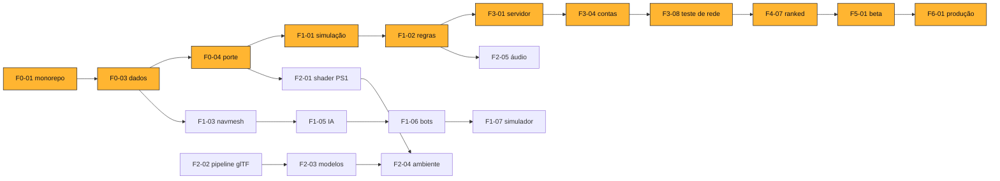

# THE HELL — Plano de construção da v1.0

**08/11/2026 · aguarda aprovação do Rodrigo antes da criação de agentes e de código**

A v1.0 (GDD-v0.2 §0, com o delta do [GDD v0.3](GDD-v0.3.md)) sai em 7 fases e 55 itens, construída por 10 agentes especialistas num ciclo de PR → CI → staging → produção. O custo de hospedagem estimado é de US$ 6 a 8 por mês, dentro do teto de US$ 10. A estimativa de calendário é de 18 a 29 semanas até o soft launch, contra 8 a 10 meses do GDD para uma equipe humana; quem define o ritmo são os portões humanos (aprovação de arte, playtests com pessoas), não a escrita de código.

O que o Rodrigo precisa fazer agora: responder às decisões da seção 7 e trazer o código do protótipo para o repositório (D-10).

---

## 1. Fases e critérios de saída

As fases são as do GDD-v0.2 §17.1. Os critérios de saída são os do GDD, mais as verificações que a CI faz.

| Fase | Objetivo | Critério de saída (verificado por) | Semanas |
| --- | --- | --- | --- |
| 0 | Monorepo, CI, deploy em staging, dados com schema, porte do protótipo | paridade com a tabela 2.3 (testes de regressão); CI verde; staging no ar | 1–2 |
| 1 | Simulação determinística, regras completas, IA com navmesh, mapa 1, HUD, simulador | partida offline completa; cobertura ≥ 90% em `packages/sim`; 1.000 partidas sem trava | 3–5 |
| 2 | Vertical slice visual: shader PS1, modelos, animação, áudio, tutorial | orçamentos de render na CI; 60 FPS em UHD 620 (medição manual); marcos A2 e A3 aprovados | 3–5 |
| 3 | Multiplayer autoritativo, caçador humano, filas, contas, loja no servidor, UI completa | 5 clientes a 150 ms e 5% de perda sem divergência (Playwright + netem); marco A4 | 4–6 |
| 4 | Conteúdo: mapas 2 e 3, Batedor, Protetor, caçadores 2 e 3, ranked, quebra-cabeças | simulador dentro da porta (D-05); marco A5 | 3–5 |
| 5 | Beta fechado, calibração com pessoas, otimização, revisão LGPD | retenção D1 > 30% no beta (GDD §17.1) | 4–6 |
| 6 | Soft launch e live-ops | temporada 1 publicada | contínuo |

## 2. Estrutura de trabalho (WBS)

Cada item vira uma issue e um ou mais PRs curtos. **Definition of Ready:** critério de aceite escrito, dependências prontas, parâmetros em `data/`. **Definition of Done:** PR revisado por agente diferente do autor, CI verde, verificação da coluna "Prova" passando, changelog atualizado. Siglas de agentes na seção 6.

### Fase 0 — Fundação

| ID | Item (backlog GDD) | Depende de | Agente | Prova |
| --- | --- | --- | --- | --- |
| F0-01 | Monorepo pnpm + Vite + Vitest + lint (T-01) | — | DEV | `pnpm build && pnpm test` na CI |
| F0-02 | CI: lint, tipos, testes, build, paleta, varredura de segredos; Dependabot | F0-01 | DEV | workflow verde no PR; PR com segredo de teste é bloqueado |
| F0-03 | `data/` com schema, YAML → JSON, recarga no dev (G-01) | F0-01 | SIM | teste: trocar valor no YAML muda o jogo sem recompilar |
| F0-04 | Porte do protótipo para TypeScript modular | F0-03, D-10 | GAM | testes de regressão com todos os valores da tabela 2.3 |
| F0-05 | Apps do Fly (staging e produção), Dockerfile, deploy de staging a cada merge, produção com aprovação, rollback documentado e testado 1 vez | F0-02 | DEV | URL de staging responde `/healthz`; registro do rollback no `docs/runbook.md` |
| F0-06 | Agentes e skills em `.claude/` (Etapa D) | aprovação deste plano | PRO | um arquivo por agente com escopo, ferramentas e critério de saída |

### Fase 1 — Jogo completo offline

| ID | Item | Depende de | Agente | Prova |
| --- | --- | --- | --- | --- |
| F1-01 | Simulação determinística, passo 1/60 s, mulberry32 (T-02) | F0-04 | SIM | mesmo hash em 100 execuções |
| F1-02 | Regras §3: fases, estados, fim (C-01, C-02), escala (C-03) | F1-01, D-01, D-02 | SIM | testes de n = 1 a 5; cobertura ≥ 90% |
| F1-03 | Navmesh por mapa + validador de mapa (§8.6, §9.1) | F0-03 | IA | validador na CI |
| F1-04 | Mapa 1 (Pátio) em JSON com 3–4 layouts, 2 gaiolas, 2 saídas (§9.3) | F1-03 | IA | todas as combinações passam no validador |
| F1-05 | IA do caçador: percepção, estados, utilidade (T-03) | F1-03 | IA | 1.000 partidas sem trava; testes de cenário |
| F1-06 | Bots aliados com fuga competente (§8.5) | F1-05 | IA | mediana de perseguição ≥ 15 s |
| F1-07 | Simulador headless + relatório §7.6 como porta (Q-01) | F1-06, D-05 | QA | relatório anexado a cada PR |
| F1-08 | Pontuação completa e resumo (G-02) | F1-02 | GAM | todos os eventos pontuam e aparecem no resumo |
| F1-09 | Dificuldades da tabela 7.3 por dados (G-05, parte 1) | F1-02 | GAM | teste por dificuldade lê o valor do YAML |
| F1-10 | HUD completo (§12.1) e i18n pt-BR, en, es | F1-02 | UI | CI falha com chave faltando |
| F1-11 | Calibração interna de velocidade (C-07) | F1-07, D-03 | QA | relatório de simulação + 5 partidas do Rodrigo e do filho |

### Fase 2 — Vertical slice visual

| ID | Item | Depende de | Agente | Prova |
| --- | --- | --- | --- | --- |
| F2-01 | Material PS1: snap, afim, Gouraud, dither, intensidades (A-01) | F0-04 | RND | capturas de referência na CI |
| F2-02 | Pipeline glTF: validador, contador de triângulos e clipes | F0-02 | ART | glTF-Validator sem erros |
| F2-03 | Modelos e animação: 3 classes + Espectro (A-02) | F2-02, A1 | ART | 9 clipes por personagem; **marco A2** |
| F2-04 | Ambiente do Pátio: luz, névoa, feixes, camadas A e B | F2-01, F1-04 | RND | **marco A3** |
| F2-05 | Música adaptativa, áudio espacial, telegraph sonoro (A-03) | F1-02 | AUD | teste de compasso; LUFS na CI |
| F2-06 | Tutorial e FTUE (§12.3) | F1-10 | UI | e2e do tutorial no Playwright |
| F2-07 | Cena de pior caso e orçamentos na CI (§10.6) | F2-03, F2-04 | RND | draw calls, triângulos e download na CI; FPS em UHD 620 medido à mão |
| F2-08 | Acessibilidade de jogo: intensidades, quebra-cabeça acessível | F2-01 | UI | checklist §12.4 |

### Fase 3 — Multiplayer

| ID | Item | Depende de | Agente | Prova |
| --- | --- | --- | --- | --- |
| F3-01 | Servidor Colyseus, snapshot filtrado, predição, reconciliação, compensação (T-04) | F1-02 | NET | testes de integração com clientes reais |
| F3-02 | Caçador controlado por pessoa (C-17) | F3-01, D-09 | GAM | partida e2e com caçador humano |
| F3-03 | Filas casual e privada (código de sala), backfill com bots | F3-01 | NET | e2e com 2 navegadores |
| F3-04 | Contas convidadas, SQLite, carteira em livro-razão (E-01) | F0-05, D-07 | NET | teste de fraude de saldo |
| F3-05 | Loja no servidor com prévia (E-02, parte 1) | F3-04, D-04 | UI | compra só pelo servidor |
| F3-06 | Telemetria §15.1, `/api/metricas`, `/api/erro` | F3-01 | QA | eventos aparecem no SQLite de staging |
| F3-07 | Segurança §13.6: validação, limites, speedhack | F3-01 | NET | testes de entrada inválida; `security-review` |
| F3-08 | Teste de rede: 5 clientes, 150 ms, 5% de perda; teste de carga | F3-01..07 | QA | relatório Playwright + netem; salas por máquina |
| F3-09 | UI completa (menus, lobby, loja, perfil, configurações) (U-01) | F3-05 | UI | axe-core sem violações; **marco A4** |
| F3-10 | Gamepad e remapeamento | F3-09 | UI | navegação só por gamepad |

### Fase 4 — Conteúdo

| ID | Item | Depende de | Agente | Prova |
| --- | --- | --- | --- | --- |
| F4-01 | Mapa 2 | F1-04, D-06 | IA + ART | validador; **marco A5** |
| F4-02 | Mapa 3 | F1-04, D-06 | IA + ART | validador; **marco A5** |
| F4-03 | Batedor (G-04) | F1-02 | GAM | uso 20–35% no simulador |
| F4-04 | Protetor (G-04) | F1-02 | GAM | uso 20–35% no simulador |
| F4-05 | Caçador 2: O Carcereiro | F1-05 | GAM + IA | contra-jogo do §4.2 testado |
| F4-06 | Caçador 3: O Lamento | F1-05 | GAM + IA | contra-jogo do §4.2 testado |
| F4-07 | Ranked: Glicko-2 por papel, tiers, temporadas (§7.5) | F3-04 | NET | teste contra os exemplos do artigo de Glickman |
| F4-08 | 5 quebra-cabeças novos com versão acessível (G-03) | F1-02 | GAM | cada um com modo acessível |
| F4-09 | XP de conta e de classe, árvore de melhorias, missões, conquistas (§5.3, §14.1) | F3-04 | GAM | tetos de 50% e 150% testados |
| F4-10 | Estado Ferido, anti-tunnel, carregar abatido (G-06) | F1-05 | GAM | regras §3.2 e §4.3 em teste |

### Fase 5 — Beta

| ID | Item | Depende de | Agente | Prova |
| --- | --- | --- | --- | --- |
| F5-01 | Playtests de 20, 50 e 200 jogadores (§15.4) | F4 | QA + Rodrigo | questionário + telemetria |
| F5-02 | Calibração com dados humanos; ajuste da porta do simulador | F5-01 | QA | métricas §7.6 com dados reais |
| F5-03 | Otimização e medição em UHD 620 | F5-01 | RND | relatório de FPS |
| F5-04 | 3 paletas do modo daltônico | F2-01 | ART | `palette-check` passa nas 3 |
| F5-05 | Soak test de 1 h, compatibilidade em 4 navegadores | F3-08 | QA | relatório |
| F5-06 | Revisão jurídica: aviso de privacidade, consentimento de menores | — | Rodrigo | parecer registrado |

### Fase 6 — Soft launch

| ID | Item | Depende de | Agente | Prova |
| --- | --- | --- | --- | --- |
| F6-01 | Deploy de produção da v1.0 | F5 | DEV | aprovação do Rodrigo no GitHub Environment |
| F6-02 | DDA em casual, modo personalizado, desafio diário (§7.4, §14.4) | F1-09 | GAM | testes por modo |
| F6-03 | Temporada 1, changelog público | F6-01 | PRO | publicação |
| F6-04 | Moeda premium e passe atrás de flag desligada (D-08) | F3-05 | NET | flag desligada em produção |

## 3. Caminho crítico e paralelismo

O caminho crítico (em destaque) passa pelo porte do protótipo, pelas regras e pelo multiplayer, e termina no beta com pessoas. Depois de F1-02, três frentes andam em paralelo: IA e simulador (IA, QA), visual e áudio (RND, ART, AUD) e rede (NET). A arte começa logo após a aprovação do marco A1, sem esperar a fase 1.

## 4. Orçamento mensal

Preços de [docs.fly.io/about/pricing](https://docs.fly.io/about/pricing), consultados em 08/11/2026. Detalhe no GDD-v0.3 §13.5.

| Ambiente | Componente | US$/mês |
| --- | --- | --- |
| Produção | shared-cpu-1x 512 MB (dorme sem uso) | até 3,69 + diferença de gru (LACUNA) |
| Produção | volume de 1 GB | 0,15 |
| Produção | saída de dados, ~1.000 partidas | ~1,70 |
| Staging | shared-cpu-1x 256 MB (dorme quase sempre) | ~0,50 |
| Staging | volume de 1 GB | 0,15 |
| — | GitHub Actions (repositório público) | 0 |
| **Total** | | **~6 a 8** |

Fora do teto e, por isso, fora da v1.0 sem decisão do Rodrigo: Postgres gerenciado, Redis, CDN, Sentry pago, segunda região, IPv4 dedicado. O que muda a conta: o preço de gru e o número de partidas. Alerta: se a fatura de um mês passar de US$ 8, o agente DEV abre uma issue com o detalhamento.

## 5. Portões humanos

| Portão | Quem | Onde fica registrado |
| --- | --- | --- |
| Aprovação deste plano e do GDD v0.3 | Rodrigo | comentário no PR destes documentos |
| Merge em `main` | Rodrigo | aprovação de PR (regra de proteção de branch) |
| Deploy em produção | Rodrigo | GitHub Environment `producao` com revisor obrigatório |
| Marcos de arte A1 a A5 (Art Bible §9) | filho | comentário na issue do marco |
| Login no Fly.io e criação do token de deploy | Rodrigo | link de login enviado pelo agente DEV; o agente nunca vê a senha |
| Playtests e recrutamento do beta | Rodrigo | issue por rodada |

Volume de PRs: se aprovar cada merge ficar pesado, uma alternativa é o Rodrigo aprovar só um PR de integração por item da WBS, e os agentes fazerem merge entre si dentro do item. Fica como opção na seção 7.

## 6. Agentes

**Inventário (Etapa A).** O repositório `cacada-sombria-V2` não tem pasta `.claude/`; não há agentes de jogo para reaproveitar. Do Caçada Sombria se reaproveita código e processo (CI, `fly.toml`, Dockerfile, build com hash, SQLite, snapshot filtrado, PRNG, predição, telemetria, créditos CC0). Skills já disponíveis na sessão e que os agentes vão usar em vez de recriar: `code-review`, `security-review`, `simplify`, `run`, `design:accessibility-review`, `engineering:testing-strategy`, `engineering:deploy-checklist`, `engineering:incident-response`.

**A criar após a aprovação (F0-06):**

| Sigla | Agente | Escopo | Critério de saída de cada tarefa |
| --- | --- | --- | --- |
| PRO | Produtor/orquestrador | issues, ordem do caminho crítico, resumo de fase, decisões pendentes | resumo de 1 página por fase |
| SIM | Simulação | `packages/sim`, `data/` schema, determinismo | determinismo em 100 execuções; cobertura ≥ 90% |
| GAM | Gameplay | classes, caçadores, quebra-cabeças, pontuação, progressão | teste de regra por mecânica |
| IA | IA e navegação | percepção, árvore de comportamento, bots, navmesh, validador de mapa | 1.000 partidas sem trava |
| NET | Rede e servidor | Colyseus, predição, contas, carteira, ranked, segurança | teste de integração e netem |
| RND | Render | shader PS1, cena, desempenho | orçamentos na CI |
| ART | Arte técnica | glTF, atlas, paleta, silhuetas | glTF-Validator; `palette-check` |
| AUD | Áudio | música adaptativa, espacial, mixagem, créditos | LUFS na CI; créditos completos |
| UI | UI/UX e acessibilidade | HUD, menus, i18n, gamepad | axe-core sem violações |
| QA | QA e balanceamento | simulador, relatórios §7.6, e2e, playtests | relatório anexado ao PR |
| DEV | DevOps e release | CI, Fly, versões, rollback, custos | pipeline verde; runbook testado |

Revisão cruzada: o PR de um agente é revisado por outro (ex.: SIM revisa GAM; NET revisa SIM; QA revisa todos os testes).

## 7. Decisões pendentes

Recomendação marcada com ★. Basta responder com o número e a letra (ex.: "D-01 a, D-02 b").

**D-01. Regra de vitória da equipe (GDD-v0.3 C-01)**
a) ★ Equipe vence se ⌈n/2⌉ escaparem ou a vida do caçador chegar a 0
b) Equipe vence se qualquer um escapar
c) Equipe vence só se todos escaparem

**D-02. Limite de tempo da partida (C-02)**
a) ★ Limite duro de 10 min
b) Limite de 12 min
c) Sem limite (o portão fica aberto até todos saírem ou morrerem)

**D-03. Caçador mais lento que o sobrevivente andando (C-07)**
a) ★ Manter 3,9 na fase 0 e decidir na fase 1 com simulação e partidas de vocês dois
b) Subir já para 4,3 m/s em Normal

**D-04. Pontos para moedas (C-09)**
a) ★ 0,3 por ponto, skins de 300 a 1.500 (uma skin a cada 3–5 partidas)
b) Manter 1:1 com os preços atuais (80 a 250)

**D-05. Simulador na CI (C-15)**
a) ★ Porta de regressão até a calibração com pessoas; porta de banda depois
b) Porta de banda desde a fase 1 (risco: CI vermelha por limitação dos bots, como no Caçada Sombria)

**D-06. Mapas 2 e 3 (o filho escolhe)**
a) ★ Hospital Abandonado e Floresta Nebulosa
b) Hospital Abandonado e Parque de Diversões
c) Floresta Nebulosa e Parque de Diversões

**D-07. Contas na v1.0**
a) ★ Convidado com código de recuperação, sem cadastro externo
b) Convidado + login com Discord
c) Convidado + login com Google

**D-08. Moeda premium e passe pago**
a) ★ Fora da v1.0; código pronto atrás de flag desligada
b) Incluir na v1.0 (exige escolher provedor de pagamento)

**D-09. Caçadores (C-17)**
a) ★ Caçador humano na fase 3; O Carcereiro e O Lamento na fase 4
b) Só o Espectro na v1.0; os outros dois na temporada 1

**D-10. Código do protótipo (HTML único, ~45 KB)**
Localizado em 08/11/2026: é o artefato `claude.ai/artifact/5gRXLcKBbwbY2shNvfjYRZ`, publicado na conversa de criação do jogo. Ele pertence a outra conta e não está compartilhado com a sessão de construção, que não consegue lê-lo. O histórico dessa conversa confere com a tabela 2.3 e o changelog 2.4 do GDD (mesmos valores de caçador, sobreviventes, gaiola, portão, pontos e moedas).
a) ★ Quem é dono do artefato abre o link, baixa ou copia o código e coloca em `prototype/the-hell.html` (ou anexa o arquivo na conversa)
b) Não é possível exportar; reconstruir a partir da tabela 2.3 do GDD (a paridade passa a ser contra a tabela, não contra o jogo)

**D-11. Aprovação de merges**
a) ★ Rodrigo aprova cada merge em `main`
b) Rodrigo aprova um PR de integração por item da WBS

**D-12. Visibilidade do repositório**
O `The-Hell-Game` é **público** hoje: o GDD, a Art Bible e os desenhos do filho ficam visíveis para qualquer pessoa. CI gratuita depende disso.
a) ★ Manter público
b) Tornar privado (Actions passa a consumir a franquia de minutos do plano do GitHub; conferir o limite)

## 8. Riscos principais

| Risco | Efeito no plano | Mitigação |
| --- | --- | --- |
| Bots não representam humanos (lição do Caçada Sombria) | simulador não calibra; fase 4 travada | D-05; fuga competente dos bots (§8.5); calibração no beta |
| Sem o código do protótipo | paridade da fase 0 sem referência real | D-10 b como alternativa |
| Preço de gru acima do esperado | teto de US$ 10 apertado | máquina dorme sem uso; staging em 256 MB; alerta a US$ 8 |
| Falta de jogadores no beta | critério D1 > 30% não medível | bots em casual; salas privadas; recrutamento pelo Rodrigo |
| Medição em UHD 620 | critério de FPS sem prova | máquina de um testador nas fases 2 e 5 |
| Aprovações humanas acumulam | fases param | opção D-11 b; resumo semanal de pendências pelo PRO |

## Fontes

[GDD v0.2](GDD-v0.2.md), [GDD v0.3](GDD-v0.3.md), [Art Bible](art-bible.md), repositório `rodaquino-OMNI/cacada-sombria-V2` (commit `486320e`), [preços do Fly.io](https://docs.fly.io/about/pricing) (08/11/2026).
